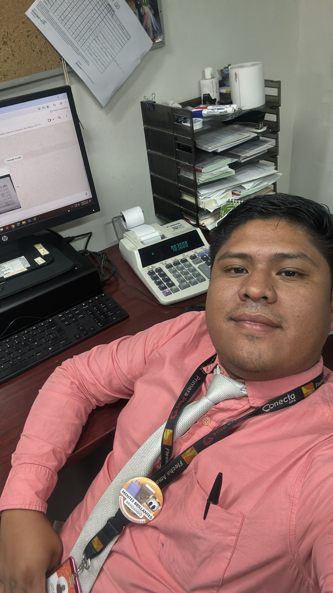

# 🚀 DEVFUSION — Portafolio Personal Full-Stack

<p align="center">
  
</p>

<p align="center">
  <strong>José Eduardo García Hurtado</strong><br>
  <em>Desarrollador Full-Stack</em>
</p>

<p align="center">
  <a href="#-tecnologías-utilizadas"></a>
  <a href="#-tecnologías-utilizadas"></a>
  <a href="#-tecnologías-utilizadas"></a>
  <a href="#-tecnologías-utilizadas"></a>
  <a href="#-tecnologías-utilizadas"></a>
</p>

---

## 📌 Descripción del Proyecto

Portafolio web profesional de alto rendimiento con temática oscura **Deep Navy / OLED**, diseñado bajo estándares modernos de **UI/UX**, accesibilidad **WCAG 2.2** y arquitectura modular. El sitio presenta una experiencia interactiva fluida para clientes y reclutadores que buscan servicios de desarrollo full-stack.

---

## 🛠️ Tecnologías Utilizadas

### 1. **Frontend & Maquetación**
| Tecnología | Versión / Tipo | Propósito en el Proyecto |
| :--- | :--- | :--- |
| **HTML5 Semántico** | Estándar W3C | Estructura accesible mediante `<header>`, `<nav>`, `<main>`, `<section>`, y `<footer>` optimizada para SEO y lectores de pantalla. |
| **Tailwind CSS v4** | v4.x | Framework de utilidades CSS para diseño responsivo móvil-primero, micro-animaciones, efectos de resplandor (*blue glow*) y variables temáticas. |
| **Vanilla JavaScript** | ES6+ | Lógica interactiva nativa, rápida y ligera sin sobrecarga de frameworks pesados. |
| **Lucide Icons** | SVG Icons | Iconografía vectorial moderna para componentes de navegación, redes sociales, servicios y estados de interacción. |
| **Google Fonts** | Inter & Caveat | • **Inter:** Tipografía principal sans-serif nítida y moderna.<br>• **Caveat:** Tipografía cursiva para la firma digital personalizada. |

### 2. **Herramientas de Construcción & Entorno**
| Herramienta | Función |
| :--- | :--- |
| **Vite** | Bundler de última generación con Hot Module Replacement (HMR) ultrarrápido y compilación optimizada con Rollup. |
| **Node.js & npm** | Entorno de ejecución y gestor de paquetes de desarrollo. |
| **Git & GitHub** | Control de versiones distribuido y despliegue remoto autenticado vía SSH (Ed25519). |

---

## ✨ Características y Funcionalidades Clave

* 🌐 **Soporte Trilingüe (i18n):** Selector interactivo desplegable con cambio instantáneo entre **Español 🇪🇸**, **Inglés 🇬🇧** y **Francés 🇫🇷**, con persistencia en `localStorage` y animación fluida *fade & blur*.
* 🧭 **Scroll Spy en el Navbar:** El menú superior detecta automáticamente la posición del usuario en la página y resalta la sección activa con un indicador iluminado en tiempo real.
* 🍱 **Bento Grid de Habilidades:** Cuadrícula asimétrica inspirada en el diseño moderno de Apple que organiza el stack MERN, métricas de rendimiento, bases de datos y buenas prácticas de ingeniería.
* 🗂️ **Filtro Dinámico de Proyectos:** Pestañas interactivas para explorar trabajos por especialidad (*Todos*, *Full-Stack*, *Frontend*, *Backend*) con transiciones suaves.
* 📋 **Copiar Correo con 1 Clic:** Botón con integración a la Clipboard API que copia el email automáticamente y muestra retroalimentación visual (*"¡Copiado!"* con icono verde).
* ⬆️ **Botón Flotante "Volver Arriba":** Acceso rápido con scroll suave que aparece de manera inteligente al descender más de 400px en la página.
* ♿ **Accesibilidad WCAG 2.2:**
  - Áreas táctiles mínimas de **44×44px** en botones interactivos y redes sociales.
  - Indicadores de foco visibles (`focus-visible`) para navegación por teclado.
  - Compatibilidad con preferencias de movimiento reducido (`prefers-reduced-motion`).
* 📖 **Guía Didáctica de Componentes:** Incluye el archivo interactivo `guia-componentes.html` con la radiografía técnica y visual de cada sección para estudio continuo.

---

## 📁 Estructura del Directorio

```text
mi-portafolio/
├── index.html               # Página principal del portafolio
├── guia-componentes.html    # Guía visual y técnica de estudio de componentes
├── vite.config.js           # Configuración del empaquetador Vite
├── package.json             # Manifiesto de dependencias y scripts
├── .gitignore               # Exclusión de node_modules y temporales
├── public/
│   └── profile.jpg          # Fotografía de perfil optimizada
└── src/
    ├── main.js              # Lógica JS: i18n, Scroll Spy, filtros y clipboard
    └── style.css            # Configuración Tailwind v4, glow effects y base
```

---

## 🚀 Instalación y Ejecución Local

Para clonar y ejecutar este proyecto en tu entorno local:

```bash
# 1. Clonar el repositorio mediante SSH
git clone git@github.com:jegh1994-collab/portafolio-prueba.git

# 2. Entrar a la carpeta del proyecto
cd portafolio-prueba

# 3. Instalar dependencias
npm install

# 4. Iniciar el servidor de desarrollo
npm run dev
```

El proyecto estará disponible inmediatamente en `http://localhost:5173/`.

### 📦 Comandos Disponibles

| Comando | Acción |
| :--- | :--- |
| `npm run dev` | Inicia el servidor de desarrollo local con Vite (HMR). |
| `npm run build` | Compila y optimiza el proyecto para producción en la carpeta `/dist`. |
| `npm run preview` | Previsualiza localmente el paquete de producción generado. |

---

## 👤 Autor

* **José Eduardo García Hurtado**
* **GitHub:** [@jegh1994-collab](https://github.com/jegh1994-collab)
* **Email:** [eduardo.garcia@email.com](mailto:eduardo.garcia@email.com)

---

<p align="center">
  Hecho con pasión ❤️ y código limpio.
</p>
